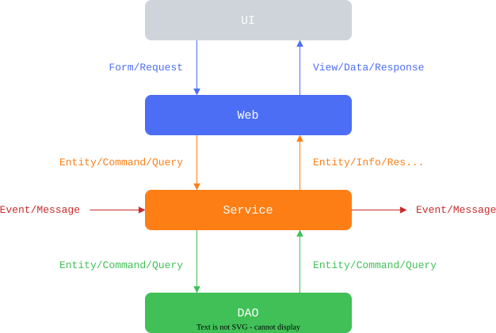

## 命名模式

定义了在分层架构中每一层传入/传出参数的命名模式。



提供了 `BaseEntity`、`BaseForm`、`BaseView`、`BaseCommand`、`BaseResult` 几个基础类。同时使用 `RestResult` 类统一前后端返回参数的结构。

## 错误码规则

将错误码（`ErrorCode`）分为两类：系统错误码（`SystemErrorCode`）和业务错误码（`BusinessErrorCode`），它们都是整数。

系统错误码是与业务无关的通用错误码，它们的取值范围为 0~99，其中 0 表示操作成功。

业务错误码是与具体业务有关的错误码，是在处理业务的过程中因违反业务规则时抛出的错误码，它们由两部分组成：模块编码（2 位）和错误编号（3 位）。模块编码由 `Module` 类定义，取值范围为 10\~99。错误编号的取值范围为 1\~999。可以将 `BusinessErrorCode` 作为参数传给 `BusinessException` 类创建业务异常。

## ID 生成器

ID 生成器使用了雪花算法，模仿 MongoDB 的 `ObjectId` 生成 `datacenterId` 和 `workerId`。

## 链路追踪 ID

尝试从请求头 `Trace-Id` 获取链路追踪 ID，如果没获取到则自定义一个。从请求头获取的好处是可以将前后端系统打通。

## 异常处理器

1. `ValidationExceptionHandler`：处理参数验证异常；
2. `DatabaseExceptionHandler`：处理访问数据库时出现的异常；
3. `BusinessExceptionHandler`：处理业务异常；
4. `GlobalExceptionHandler`：处理全局异常，即没有异常处理器处理的异常；

## 响应参数处理器

在 `Controller` 中的方法的返回参数的类型可以是 `ResultResult` 类，也可以是其他类型。

## 分布式锁

基于 Redis 实现了一个简单的分布式锁，在需要加锁的方法上添加 `@Lockable` 注解即可，支持 SpEL 表达式。

## 数据库读写分离

主从数据源配置示例

```yaml
duck:
  datasource:
    hikari:
      primary:
        jdbc-url: jdbc:mysql://localhost:3306/duck_primary?characterEncoding=UTF-8&serverTimezone=GMT%2B8
        driver-class-name: com.mysql.cj.jdbc.Driver
        username: root
        password: 123456
      replica:
        jdbc-url: jdbc:mysql://localhost:3306/duck_replica?characterEncoding=UTF-8&serverTimezone=GMT%2B8
        driver-class-name: com.mysql.cj.jdbc.Driver
        username: root
        password: 123456
```

默认使用主库，可以使用 `@DataSourceSelector` 注解切换从库。

## JSON 类型处理器

`duck-mybatis` 提供两组 JSON 类型处理器：数据库无关的实现放在 `type` 包，厂商专用实现放在 `type.<vendor>` 子包。

- `type.postgres.JsonTypeHandler` / `type.postgres.JsonbTypeHandler`：PostgreSQL 原生 `json` / `jsonb` 列，按 `PGobject` 绑定；
- `type.JsonTypeHandler`：以文本保存 JSON 的列，包括 PostgreSQL 的 `text` / `varchar`、MySQL 5.7.8+ 的 `JSON`（MySQL 没有 `jsonb`）、MariaDB 的 `JSON`。它按字符串绑定，不依赖 PostgreSQL JDBC 驱动。
- 两个包都预置了常用元素类型的集合处理器：文本/MySQL 用根包的 `type.<元素类型>ListJsonTypeHandler`，PostgreSQL 原生 `json` / `jsonb` 用 `type.postgres.<元素类型>ListJsonTypeHandler` / `<元素类型>ListJsonbTypeHandler`。每个预置集合处理器都有无参和 `(ObjectMapper)` 两个构造器：无参使用全局默认 mapper，`(ObjectMapper)` 供直接实例化或自定义子类使用；MyBatis 的注解/XML 仍走无参构造器，单字段换 mapper 写一个 `super(mapper)` 的小子类即可。

两个包都使用 `JsonTypeHandler` / `BaseJsonTypeHandler` / `<元素类型>ListJsonTypeHandler` 等短名，靠包名区分；同一个文件同时使用 PG 原生列和文本列时，其中一个需要写全限定名。

`Class` 构造器适用于普通 Bean；任何带类型参数的类（集合、`Map`、`Iterable`、`Optional`、`Map.Entry`、自定义泛型 Bean/容器）以及元素为它们的数组（如 `List<Foo>[]`）都无法保留泛型信息，需要用 `TypeReference` 自定义处理器（`Class` 自身带类型参数，但仍按标量目标用 `Class` 构造器）。具体集合/`Map` 子类如果自身没有类型参数（如 `class Tags extends ArrayList<String>`）可以用 `Class`。

`Map`/`Set` 不预置：JSON object 已知结构优先具体类，动态对象才用 `Map<String,Object>`；JSON array 优先 `List`，Set 的顺序/去重语义与 JSON 数组不完全一致。需要时用 `TypeReference` 自定义，示例见 `type/package-info`。

处理器由 MyBatis 反射实例化，只能在 `@Results` / XML 中显式指定；未显式传入 `ObjectMapper` 的处理器在构造时取 `ObjectMapperHolder.getDefault()`。应用只需在启动早期、MyBatis 解析 mapper 和构造处理器之前调用一次 `setDefault`；之后再替换只影响新构造的处理器。Spring Boot 放在 `ConfigurationCustomizer` 里执行：

```java
@Bean
ConfigurationCustomizer duckJsonObjectMapperCustomizer() {
    return configuration -> ObjectMapperHolder.setDefault(ObjectMapperHolder.createDefault().setPropertyNamingStrategy(PropertyNamingStrategies.SNAKE_CASE));
}
```

普通 MyBatis 在 `SqlSessionFactoryBuilder#build` 之前调用 `setDefault`。设置是替换而不是合并：传入的 mapper 不会被库修改，也不会继承 `createDefault()` 的基线配置；需要基线时从 `createDefault()` 起手。`resetDefault()` 用于上下文关闭或测试清理。

全局默认值只有一份，且是 JVM/ClassLoader 级别的。不同 `SqlSessionFactory` 或单个字段需要不同 mapper 时，不要依赖全局默认值；用显式传入 `ObjectMapper` 的处理器构造器，或写一个调用 `super(mapper, type)` 的处理器子类。一个 `SqlSessionFactory` + 动态数据源仍然只有一份配置；不同物理库需要不同 JSON 格式时，应拆成多个工厂，并给每个工厂的处理器显式传入各自的 mapper。

普通 MyBatis、集合列、日期时间约定与限制等完整说明见 [`type/package-info.java`](duck-mybatis/src/main/java/me/acomma/duck/mybatis/type/package-info.java) 与 [`type.postgres/package-info.java`](duck-mybatis/src/main/java/me/acomma/duck/mybatis/type/postgres/package-info.java)。

## 缓存扩展

在使用 Spring Cache 的基础上使用 `@CacheExtension` 注解定义缓存过期时间。

## Swagger 文档

增强 SpringDoc 文档，无论 `Controller` 方法返回值是否是 `ResultResult` 类均有一致的文档结构。
